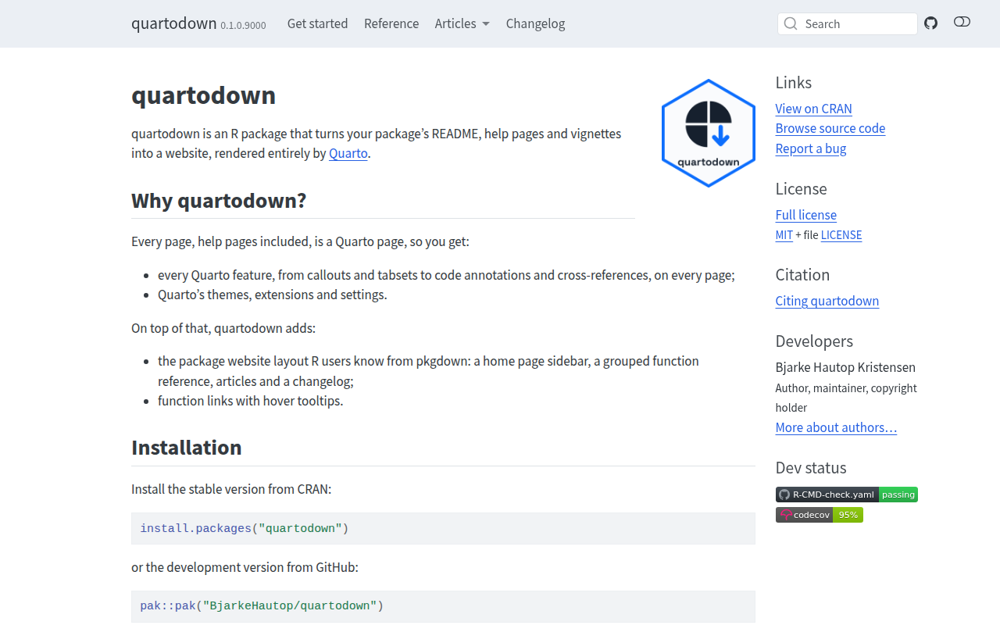
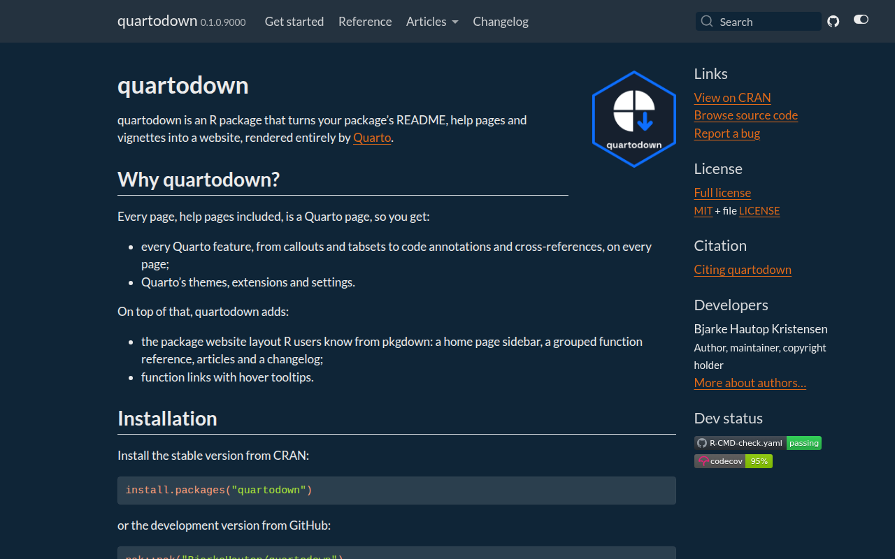
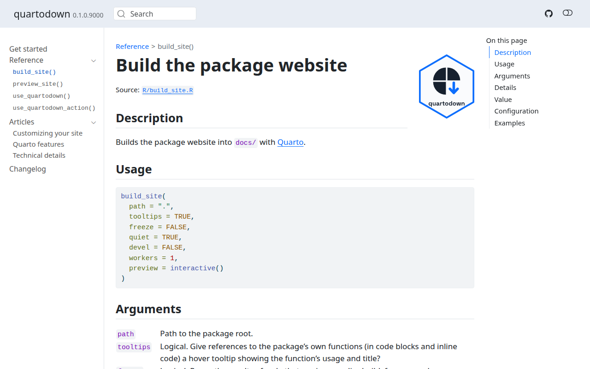
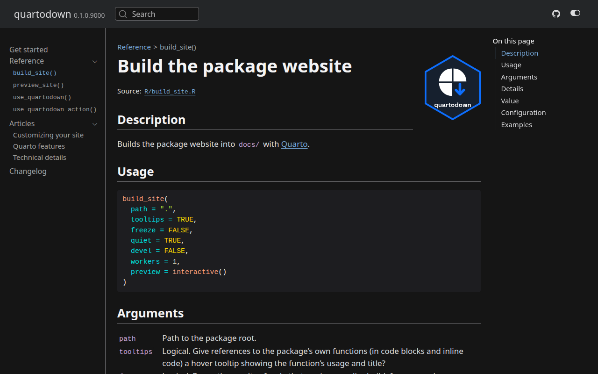
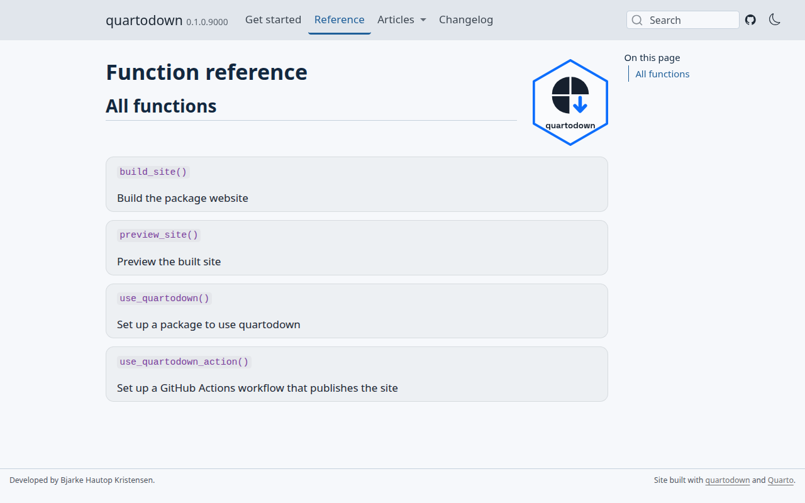
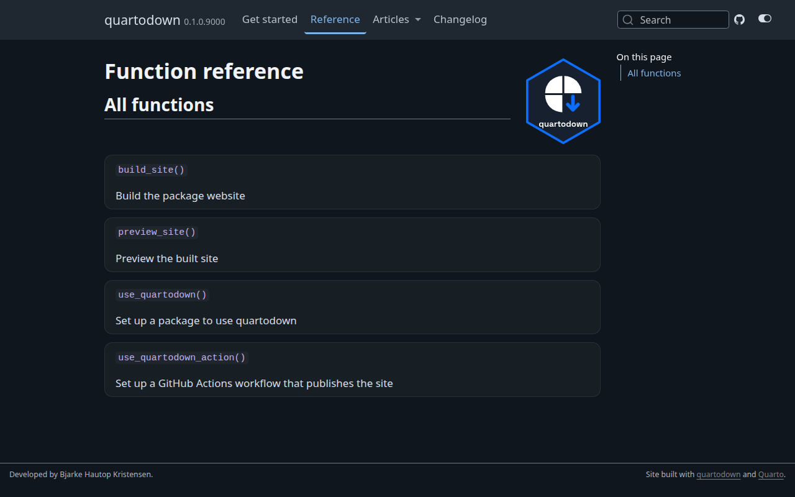

# Gallery

Source: [`vignettes/articles/gallery.qmd`](https://github.com/bjarkehautop/quartodown/blob/HEAD/vignettes/articles/gallery.qmd)

This site uses quartodown’s defaults. Each screenshot below shows the same site built with the settings under it; click one to enlarge it. The screenshots follow your light or dark mode. See [Customizing your site](../../vignettes/customizing.llms.md) for every setting.

## A built-in theme

`theme:` picks any of Quarto’s [built-in themes](https://quarto.org/docs/output-formats/html-themes.html), here `cosmo` in light mode and `superhero` in dark mode. A theme can also be your own `.scss` file in `_quartodown/`.

[](gallery/theme/light.png)

[](gallery/theme/dark.png)

> **NOTE:**
>
> `_quartodown/_quartodown.yml`:
>
> ``` yaml
> theme:
>   light: cosmo
>   dark: superhero
> ```

## A sidebar

`navbar: style: sidebar` moves the navigation into a sidebar beside every page, which also lists every reference page.

[](gallery/sidebar/light.png)

[](gallery/sidebar/dark.png)

> **NOTE:**
>
> `_quartodown/_quartodown.yml`:
>
> ``` yaml
> navbar:
>   style: sidebar
> ```

## A custom look

Your own `.scss` files as themes set the colors, here a blue tint in light mode and a navy page in dark mode. `_quartodown/extra.scss` restyles any part of the site in both: here rounder code blocks and the function reference as cards.

[](gallery/custom/light.png)

[](gallery/custom/dark.png)

> **NOTE:**
>
> `_quartodown/_quartodown.yml`:
>
> ``` yaml
> theme:
>   light: _quartodown/blue-light.scss
>   dark: _quartodown/blue-dark.scss
> ```
>
> `_quartodown/blue-dark.scss`:
>
> ``` scss
> /*-- scss:defaults --*/
> // The same blue on a navy page.
> $primary: #7fb3e6;
> $link-color: $primary;
> $body-bg: #10161d;
> $body-color: #d6dde5;
> $headings-color: #f0f4f8;
> $text-muted: #9aa8b6;
> $border-color: #6b7a8a;
> $code-color: #c3b1e8;
> $code-bg: $body-bg;
> $code-block-bg: #18212b;
> $pre-color: inherit;
>
> // Bootstrap's defaults for these are meant for a light page.
> $input-bg: #1c2530;
> $popover-bg: #1c2530;
> $footer-bg: $body-bg;
> $dropdown-bg: $body-bg;
> $dropdown-color: $body-color;
> $dropdown-link-color: $body-color;
> $dropdown-link-hover-color: $headings-color;
> $dropdown-link-hover-bg: #2a3542;
> $nav-tabs-link-active-color: $body-color;
> ```
>
> `_quartodown/blue-light.scss`:
>
> ``` scss
> /*-- scss:defaults --*/
> // A cool, blue-tinted page.
> $primary: #1f5f99;
> $link-color: $primary;
> $body-bg: #f6f8fb;
> $body-color: #1c2733;
> $headings-color: #12283f;
> $border-color: #c5d0dc;
> $code-color: #7a3e9d;
> $code-block-bg: #e8eef5;
> ```
>
> `_quartodown/extra.scss`:
>
> ``` scss
> /*-- scss:rules --*/
> // Rounder code blocks, marked with the accent.
> div.sourceCode {
>   border-radius: 0.75rem;
>   border-left: 4px solid $primary;
> }
>
> // Each function on the reference index as a card, below the logo.
> dl.ref-index {
>   clear: both;
> }
>
> dl.ref-index dt,
> dl.ref-index dd {
>   background: rgba($body-color, 0.04);
>   border: 1px solid rgba($body-color, 0.1);
>   padding: 0.5rem 1rem;
> }
>
> dl.ref-index dt {
>   border-bottom: none;
>   border-radius: 0.75rem 0.75rem 0 0;
> }
>
> dl.ref-index dd {
>   border-top: none;
>   border-radius: 0 0 0.75rem 0.75rem;
>   margin-bottom: 0.75rem;
> }
> ```
