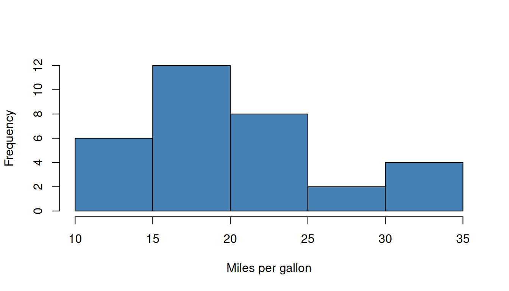
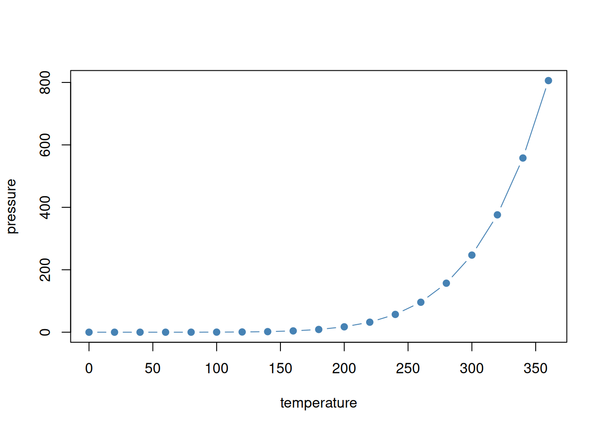
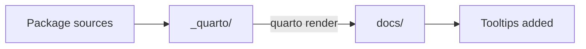

# Quarto features

Source: [`vignettes/articles/showcase.qmd`](https://github.com/bjarkehautop/quartodown/blob/HEAD/vignettes/articles/showcase.qmd)

quartodown renders every page with Quarto itself, so all of Quarto’s features for writing documents work in your vignettes and articles. This page shows some of them as they look on a quartodown site, each with the source that makes it.

## Callouts

> **NOTE:**
>
> Callouts draw attention to a piece of text. There are five types: `note`, `tip`, `important`, `warning` and `caution`.

> **TIP:**
>
> Give a callout a title with a heading as its first line.

> **WARNING:**
>
> Callouts can be collapsible, which is handy for details most readers can skip.

Source

``` markdown
::: {.callout-note}
Callouts draw attention to a piece of text. There are five types: `note`, `tip`,
`important`, `warning` and `caution`.
:::

::: {.callout-tip}
## Tip with a title

Give a callout a title with a heading as its first line.
:::

::: {.callout-warning collapse="true"}
## Click to expand

Callouts can be collapsible, which is handy for details most readers can skip.
:::
```

## Tabsets

Tabsets show alternative views of the same thing, one at a time:

## Summary

``` r
summary(mtcars$mpg)
#>    Min. 1st Qu.  Median    Mean 3rd Qu.    Max. 
#>   10.40   15.43   19.20   20.09   22.80   33.90
```

## Plot

``` r
hist(mtcars$mpg, main = NULL, xlab = "Miles per gallon", col = "steelblue")
```



## By cylinders

``` r
aggregate(mpg ~ cyl, data = mtcars, FUN = mean)
#>   cyl      mpg
#> 1   4 26.66364
#> 2   6 19.74286
#> 3   8 15.10000
```

Source

```` markdown
::: {.panel-tabset}
## Summary

```{r}
#| label: tabset-summary

summary(mtcars$mpg)
```

## Plot

```{r}
#| label: tabset-plot
#| fig-height: 4

hist(mtcars$mpg, main = NULL, xlab = "Miles per gallon", col = "steelblue")
```

## By cylinders

```{r}
#| label: tabset-by-cyl

aggregate(mpg ~ cyl, data = mtcars, FUN = mean)
```
:::
````

## Code annotations

Hover over the numbers to see the annotations.

``` r
quartodown::use_quartodown() # <1>
quartodown::build_site(devel = TRUE) # <2>
```

1.  Write `_quartodown.yml` and gitignore the build output.
2.  Build the site, loading the package with `pkgload::load_all()`, and open it in your browser.

Source

```` markdown
---
code-annotations: hover
---

```r
quartodown::use_quartodown() # <1>
quartodown::build_site(devel = TRUE) # <2>
```

1. Write `_quartodown.yml` and gitignore the build output.
2. Build the site, loading the package with `pkgload::load_all()`, and open it
   in your browser.
````

## Function links

Functions from this package are linked to their reference page, with a tooltip on hover, both inline, like `build_site()`, and in code:

``` r
build_site(devel = TRUE)
preview_site()
```

In code, functions from other packages are linked to their own documentation, like `summary()` in the tabset above.

## Footnotes and margin content

Footnotes are written with `[^name]`.[^1] Quarto shows them at the end of the page, and as a popup when you hover over the reference.

Source

``` markdown
Footnotes are written with `[^name]`.[^footnote]

[^footnote]: This is a footnote. It can contain *formatting*, `code` and
    [links](https://quarto.org/).
```

Content can also be placed in the margin.

This note sits in the margin, next to the paragraph it belongs to.

Source

``` markdown
::: {.column-margin}
This note sits in the margin, next to the paragraph it belongs to.
:::
```

## Figures and cross-references

Code output, such as plots, gets a caption and a label you can reference: see [Figure 1](#fig-pressure).

``` r
plot(pressure, type = "b", pch = 19, col = "steelblue")
```



Figure 1: Vapor pressure of mercury as a function of temperature.

Tables can be cross-referenced in the same way, as in [Table 1](#tbl-cars).

``` r
knitr::kable(head(mtcars[, 1:6]))
```

|                   |  mpg | cyl | disp |  hp | drat |    wt |
|:------------------|-----:|----:|-----:|----:|-----:|------:|
| Mazda RX4         | 21.0 |   6 |  160 | 110 | 3.90 | 2.620 |
| Mazda RX4 Wag     | 21.0 |   6 |  160 | 110 | 3.90 | 2.875 |
| Datsun 710        | 22.8 |   4 |  108 |  93 | 3.85 | 2.320 |
| Hornet 4 Drive    | 21.4 |   6 |  258 | 110 | 3.08 | 3.215 |
| Hornet Sportabout | 18.7 |   8 |  360 | 175 | 3.15 | 3.440 |
| Valiant           | 18.1 |   6 |  225 | 105 | 2.76 | 3.460 |

Table 1: The first rows of the `mtcars` data.

Source

```` markdown
Code output, such as plots, gets a caption and a label you can reference: see
@fig-pressure.

```{r}
#| label: fig-pressure
#| fig-cap: "Vapor pressure of mercury as a function of temperature."

plot(pressure, type = "b", pch = 19, col = "steelblue")
```

Tables can be cross-referenced in the same way, as in @tbl-cars.

```{r}
#| label: tbl-cars
#| tbl-cap: "The first rows of the `mtcars` data."

knitr::kable(head(mtcars[, 1:6]))
```
````

## Colored output

Output keeps the colors it has in the console, such as cli’s messages and errors:

``` r
cli::cli_h2("Checking {.pkg quartodown}")
#> 
#> ── Checking quartodown ──
#> 
cli::cli_alert_success("Found {.val {3}} vignettes.")
#> ✔ Found 3 vignettes.
cli::cli_abort(c(
  "Can't find {.file _quartodown.yml}.",
  "i" = "Create one with {.fn quartodown::use_quartodown}."
))
#> Error:
#> ! Can't find _quartodown.yml.
#> ℹ Create one with `quartodown::use_quartodown()`.
```

and tibbles:

``` r
tibble::tibble(x = c(-1.5, NA, 3), y = c("a", NA, "c"))
#> # A tibble: 3 × 2
#>       x y    
#>   <dbl> <chr>
#> 1  -1.5 a    
#> 2  NA   NA   
#> 3   3   c
```

## Math

Inline math, like $e^{i\pi} + 1 = 0$, and display math:

$$\bar{x} = \frac{1}{n} \sum_{i=1}^{n} x_i
\tag{1}$$

Equations can be referenced too: [Equation 1](#eq-mean) is the sample mean.

Source

``` markdown
Inline math, like $e^{i\pi} + 1 = 0$, and display math:

$$
  \bar{x} = \frac{1}{n} \sum_{i=1}^{n} x_i
$$ {#eq-mean}

Equations can be referenced too: @eq-mean is the sample mean.
```

## Diagrams

Mermaid and Graphviz diagrams are drawn from text:



Source

```` markdown
```{mermaid}
%%| label: build-diagram

flowchart LR
  A[Package sources] --> B[_quarto/]
  B -->|quarto render| C[docs/]
  C --> D[Tooltips added]
```
````

## Layout

Content can be arranged in columns:

**Left column.** Quarto’s layout options arrange content, including figures, in a grid.

**Right column.** On narrow screens the columns stack.

Source

``` markdown
::: {layout-ncol="2"}
::::: {}
**Left column.** Quarto's layout options arrange content, including figures, in
a grid.
:::::

::::: {}
**Right column.** On narrow screens the columns stack.
:::::
:::
```

## Learn more

See the [Quarto guide](https://quarto.org/docs/guide/) for everything else Quarto can do.

## Footnotes

[^1]: This is a footnote. It can contain *formatting*, `code` and [links](https://quarto.org/).
